# v62 status: where the refactor stands (2026-11-17, spun down)

`release/62` is the unified v62 branch: everything built so far, plus the work in progress (as patches under `FSD/v62_wip/`). It is not a release yet. `CHANGELOG.md` `## [62.0.0] - UNRELEASED` carries each slice's changes, tests and adoption notes.

## The goal

v62 moves persist onto the CIRIS kernel crate and the CC v1.0-rc20 clean mesh. "Nothing carries": a v62 node accepts and produces only edition-2 (CBOR/COSE, composite-signed) statements, starts from `ceg-genesis-bundle/2`, and deletes its v61 store at upgrade. The same node module also runs in a browser (wasm32) and UEFI.

## Pins

| Dependency | Pin on this branch | Target for the v62 tag |
|---|---|---|
| ciris-kernel | tag `kernel-v0.2.0` | same |
| CIRISVerify | tag `v23.1.3` | `v23.3.0`, the halt-reader fix (not yet tagged); slice C bumps it |
| CC | rc20 read, not vendored | `v1.0-rc20` (tag d4bd2a6), vendored in slice C |

## Merged here (each slice's own tests green; full lib lane 4,993 at J0)

- **A: host seams.** Clock, executor and lifecycle (`src/host/`), so node code makes no direct clock, spawn, signal or `block_on` calls.
- **B: storage profile.**
  - the attestation read seeks V216 in order (two-phase on SQLite);
  - the host open profile (exclusive-first WAL, zero readers);
  - persist's own migration runner.
- **C: kernel adapter** (`src/kernel/`, kernel-v0.2.0).
  - consensus, owner_of, the trust edge leg and the cycle gate answer through the kernel, after `layers::kept`;
  - the departures are adopted;
  - benchmarks are at or near the pre-kernel baseline.
- **D: Verify 23.1.3.**
  - composite-only signatures; earlier-form objects are refused at the door;
  - the node/host feature split;
  - the wasm node gate, linking a module with exactly 3 `ciris:node/*` imports;
  - encrypted-kv on wasm.
- **E1: rc20 rules on the earlier wire.**
  - the identity-set exclusion;
  - canonical as a conferral; substrate_persist confers nothing;
  - X-Wing transit/hop keys, live only by rebind;
  - accord recovery (CC 4.2.6);
  - licensure waits for its quorum;
  - typed KeyRecordConflict;
  - the infrastructure carve-out re-keyed (a security fix).
- **E2a: the edition-2 door** (`federation::edition2`, `Engine::put_edition2_statement`).
  - row ids are node-computed; names come from `refs`;
  - HeldKeys liveness;
  - the generic parts of genesis bundle/2, and `put_genesis_bundle`;
  - the CDE purge digest.
- **E2b: the V300 edition-2 schema baseline,** equal to V001..V216, plus `delete_earlier_store` at open (legal-hold guard, dry run, refuses a foreign or other-owner schema).
- **J0: reconciliation.**
  - edition-2 keys and revocations are projected into `federation_keys` / `federation_revocations` as read models, with one fold;
  - the cross-form refusal `earlier_form_signer_is_edition2`;
  - the test codec (`edition2::codec`), the producer (`edition2::produce`) and `edition2_statements_since`.

The kernel performance work is upstream in CIRISKernel PR #3, released as `kernel-v0.2.0`.

## Work in progress (`FSD/v62_wip/`, not applied)

Both shutdown slices were stopped at spin-down. Neither compiles yet, so the pre-commit hook refused them. Apply each with `git apply --index` on a branch cut from this commit.

### `v62-cut-a.staged.patch` (JSON cut slice A: inbound doors)

**Done:**
- the switch `edition2::door::EARLIER_FORM_DOORS_SHUT = false`, with `refuse_earlier_form(plane)` / `refuse_earlier_form_row`;
- that refusal wired as the first line of 28 JSON doors;
- `apply_replicated_statement` (never compiled).

**To clear the hook:** the test-only `with_earlier_form_doors_shut` has no caller yet.

**Next, in design order:** `put_statement` builds the earlier Signed* struct from the verified voices, then runs the existing planned door inside a task-local "vouched" scope.
1. In that scope:
   - `verify_hybrid` accepts the composite;
   - the earlier-form refusal passes;
   - JSON row minting and the cosign hold are skipped.
2. Counted rows: store the statement, count the voices; short → `Pending`; met → the mapped row, then the projection.
3. The classifiers skip rows that carry `ceg_statement`.
4. `attestation_of` writes `references_attestation_id` from `refs.target`.
5. A composer whose target is not held waits (`WithdrawsTargetUnheld`).

**Halt** (CC 4.2.1.1):
- the roster is the bundle in force for `accord_root`; with none held, the halt waits;
- an unknown kid waits;
- `iss_not_holder` is refused;
- one holder's composite statement latches the halt.

**Also to build:**
- `edition2::payloads`, the payload mapping, which CC has adopted as the reading; plus `docs/EDITION2_PAYLOADS.md` for CC;
- `composer_family_mismatch`;
- the `accord_invocation_replayed` dedup (invocation_id / nonce within valid_until);
- `location_proof:v1`, with its witnesses ignored until Verify registers the family;
- `trust:blessing`.

**Open rulings:**
- delivery receipts: store the composite's halves in `HybridSignature`;
- later `group:roster` versions (the supersede path);
- typed tables for `revocation:{entity}` (non-key), `cosign:{state}` and `takedown_notice`.

### `v62-cut-b.staged.patch` (JSON cut slice B: producers and serving)

**Done:**
- the v31 re-stamp migration is deleted;
- the PQC cold path is mostly deleted.

**To finish the deletion:**
- remove the remaining `CompletePqc`, `AttachPqc` / `plan_key_attach_pqc` and `HybridPendingRow`;
- fix the tests that still call the deleted methods;
- drop the `.pyi` and FFI classification rows for `attach_*_pqc_signature` and `run_pqc_sweep`.

**Keep:** `adopt_scrub_upgrade` until slice C, because genesis seeding still uses it.

**Next:**
- `register_self_federation_key` writes a `key:record` and returns the identity-ref, dropping `roles`, `identity_ref` and `registration_envelope`;
- `local_derived_key_id()` returns the identity-ref;
- producers move to `sign_row` + `put_statement`;
- delegations use the CC-confirmed families:
  - `self:delegates_to`;
  - `ownership:{relation}:{target_kind}:{version}`, with the node as second voice;
  - `self:delegates_to:agent_occurrence`;
  - `trust:{job}:{version}`;
- withdraws / recants / supersedes carry the target's family;
- serving goes through `edition2_statements_since`, with lookups by row/statement id and the wire index keyed on statement_id;
- drafts become a CBOR payload plus Sig_structure.

### `w614-lts-floor.removal-floor.patch`

The 61.4 removal-floor work-in-progress (commits after v61.4.0 on `w614-lts-floor`). It is unreviewed and was never merged; re-target it to the kernel model before using it.

## Parallel write wave (2026-11-18): current state, read this first

The plan below was replaced by a **no-build parallel wave**. Up to 20+ agents write code without compiling, and a single integration lane builds. The machine allows ONE heavy build at a time, coordinated through the CIRISServer session; ask it for a slot first.

- **The rules every agent follows:** `FSD/v62_wip/parallel/CONTRACT.md`.
- **Deliverables:** every agent's patch, notes and API files are in `FSD/v62_wip/parallel/` (`<ID>.patch`, `<ID>.md`, `<ID>.api.md`).
- **Bases:**
  - slice A committed: `v62-cut-a@23c0d30a`;
  - slice B committed: `v62-cut-b@4deb020f`;
  - the integration tree is built by X2's scripts (`X2-integrate.sh`, `X2-fixes.sh`, `X2-resolve.py`) on top of A and B (worktree `/home/emoore/CIRISPersist-wx2`). Patches named `*-cutb*` apply after B.
- **Production patches:**
  - genesis bundle/2, boot and the Verify pin: C1–C5;
  - host surfaces: D1–D3;
  - test codec: E0;
  - kernel pass 2: K1, K2;
  - payloads and the door: P1e (cumulative), P2/P2b/P2c, P3, P4, P5/P5b/P5c, P6, P7 (composite traces), P8 (remaining re-signing paths and producers);
  - typed projections: T1, T2;
  - occurrences: O1;
  - counted voices / Pending: V1 (V1-onX2);
  - trust root: W1/W1b;
  - shutting the earlier form: F0 (F0-onX1 and F0-switch at CP2 only).
- **Test fixture flip:** E1–E13, each owning files, with held tests wrapped in `with_earlier_form_async`.
- **CC 2.7 migration (Eric: all of it in v62):** the door refuses only on the statement's own bytes and the signer's key plane. Every other-row condition is held and concludes nothing, with a reason. G0 is the architect (mechanism); G1–G3 audit every gate; a conversion fan-out follows.
- **Verify:** v62 pins Verify 23.3.1, re-vendored at CC's non-release tag `v1.0-rc21-wire`. All `TODO(verify-rc21)` door overrides MUST be removed at that re-pin, before the tag.
- **Rulings made today:** in the memory log `project_final_refactor_fsd.md`, and in the agents' `.md` notes. The key ones:
  - a key embedded in a family name is its bare thumbprint;
  - key-record coverage is half-open, and `valid_until_not_after_asserted_at` is refused;
  - an occurrence binds its own identity, with the person/machine exclusion on every door;
  - a trust grant is `trust:accepts:v1`;
  - an affiliation owner binding and an officer appointment are counted voices;
  - a replicating trace is composite;
  - an amendment is held, not refused.

## Remaining to the v62 tag: plan, order and checkpoints (SUPERSEDED in part by the wave above)

Durations are effort estimates for one agent working on a cold build, not dates. Two cargo builds at a time is the machine limit that set the parallelism.

```mermaid
gantt
    title v62 remaining work (dependency order)
    dateFormat  X
    axisFormat  %s
    section JSON cut
    A finish: inbound doors + payloads + halt + dedup   :a, 0, 3d
    B finish: PQC delete + producers + serving        :b, 0, 3d
    C genesis bundle/2 + boot + Verify 23.3.0 + rc20   :c, after b, 3d
    D PyO3 / capsule / HTTP surfaces                   :d, after a, 2d
    CP1 merge A+B+C+D into release/62                  :milestone, cp1, after c d, 0d
    E fixture flip (~3,270 tests, 2 agents by file)    :e, after cp1, 5d
    F shut doors + delete dead code + from-disk gate   :f, after e, 1d
    CP2 edition-2 only, full suite green               :milestone, cp2, after f, 0d
    section Kernel pass 2
    K2 forks-as-tips, 21 breakers, windows, key_end    :k2, after cp1, 3d
    section Release
    R1 rc20 evidence re-stamp + adoption notes         :r1, after cp2 k2, 1d
    R2 certify + wheel pytest + wasm gate + benches    :r2, after r1, 1d
    CP3 release.sh 62.0.0 --hold                       :milestone, cp3, after r2, 0d
```

### Checkpoints (the exit criteria an agent must show before moving on)

| ID | Step | Depends on | Exit criteria |
|---|---|---|---|
| A | Finish `v62-cut-a.staged.patch` | release/62 | The patch applies and compiles; `edition2::payloads` exists with `docs/EDITION2_PAYLOADS.md`; every family's door lands in its typed table on sqlite+pg; `composer_family_mismatch`, `accord_invocation_replayed` and the halt (unknown kid waits, `iss_not_holder` refused) are witnessed and mutation-tested; the switch is still OFF; the full lib lane is green. |
| B | Finish `v62-cut-b.staged.patch` | release/62 | The PQC cold path is fully deleted (pyi and FFI rows gone); every MESH producer emits through `sign_row`; a two-node witness shows each produced row admitted by `put_statement` on a second node; `register_self_federation_key` returns an identity-ref; serving goes through `edition2_statements_since`; the full lib lane is green. |
| C | Genesis bundle/2 and boot | B (shares `engine.rs`) | Verify pinned at 23.3.0 (all crates together); CC rc20 vendored (`evidence/cc_impl.tsv` re-stamped; span_sha256); `put_genesis_bundle` uses Verify's `read_genesis_bundles` / `follow_to_head`; `test_ceremony_v2`; a fresh node boots pre-genesis; canonical = `serve_nodes`; Verify's `genesis_bundles_v2.json` replays; bundle/1 and the JSON seeds deleted; `adopt_scrub_upgrade` removed. |
| D | Host surfaces | A | PyO3 gets `put_edition2_statement`, `apply_replicated_statement`, `bundles_in_force_json` and `edition2_statements_since`; earlier-form PyO3 doors raise `ValueError(federation_malformed_row: earlier_form_object)` behind the switch; capsule ops appended (append-only gate); pyi check green; a Python round-trip witness. |
| **CP1** | Merge A–D into release/62 | A, B, C, D | Each slice's witnesses rerun after its merge; the full lib lane, the pyo3 lane, the five axes, all-features clippy, deny and the wasm gate all green; `accord_lineage_v2.json` sha256 unchanged. |
| E | Fixture flip | CP1 | The 37 builders emit edition 2 by default; literal sites rewritten with `statement_of`, `kid()` and `rid()`; earlier-form behaviour tests deleted; at most 2 agents, partitioned by file (`federation/*_invariants` A–M, N–Z, `store/`, `ffi/`, `tests/`). |
| F | Shut the doors | E | `EARLIER_FORM_DOORS_SHUT = true`; every earlier-form door refuses by name (witnessed); `TODO(json-cut)` sites and the baked JSON genesis deleted; a from-disk gate stops any write door from reopening the earlier form. |
| **CP2** | Edition-2 only | F | The full suite is green with the switch ON and no earlier-form producer left. |
| K2 | Kernel pass 2 | CP1 | `held_head_verdict` holds forks as tips; the 21 breaker gates and the single-owner gate deleted; windows and sweeps replaced; key_end liveness through the kernel; the differential shows no unnamed class; the canary `kernel_still_needs_own_withdrawal_filter` still passes, or the filter is removed if a kernel tag fixed it. |
| R1 | Evidence and notes | CP2, K2 | Register rows re-filed at CC 8.11; `CLM-identity-set` etc. pointers current; the CHANGELOG adoption notes for Edge, Server, Agent and Bridge are complete. |
| R2 | Release gates | R1 | `scripts/certify.sh` full, every leg; the wheel pytest; the wasm gate; the benches against `pre-kernel` (restore from `FSD/v62_docs/criterion-pre-kernel/`, or re-record on the same machine) at or below 1.0× within noise; PR CI green. |
| **CP3** | Cut | R2 | `scripts/release.sh 62.0.0 --hold`; then ship; then `scripts/release_finish.sh`. |

### Known blockers outside persist

- **Verify v23.3.0:** the halt reader fix, the rc20 re-vendor and the derived act. Blocks C's pin bump, and the un-ignoring of A's halt-v2 and location_proof witnesses.
- **CC next edition:** the location_proof / trust:blessing family cards and the text for the readings marked *next edition* in `FSD/v62_docs/RULINGS.md`. Not blocking: persist builds to the readings.

## How a resuming agent works

- **Read first:**
  - `FSD/v62_docs/RULINGS.md`, for every decision;
  - `FSD/v62_docs/JSON_CUT_PLAN.md`, the inventory and per-slice brief;
  - `FSD/v62_docs/CC_FAMILYMAP_ANSWER.md`;
  - `FSD/v62_docs/VERIFY_GENESIS_READER_API.md`;
  - the CHANGELOG `## [62.0.0]`.
  `FSD/v62_docs/PROJECTION_BRIEF.md` is already built (J0); keep it for reference.
- **Resume a WIP slice:** cut a branch from `release/62` and `git apply --index FSD/v62_wip/<patch>`.
- **The repository's rules:**
  - every cargo / nextest / mutants / deny command and every `git commit` goes through `scripts/cargo_guard.sh`;
  - postgres tests run via `scripts/pg_test_db.sh -- <cmd>`;
  - test every backend (sqlite AND postgres);
  - never `git commit --no-verify`, `--amend`, `reset`, `stash` or force;
  - shipped migrations are immutable (V300 is not shipped yet);
  - `#![deny(unsafe_code)]`.
- **Invariant numbers already used:** I1790–I1859, I1870–I1912, I1950–I1959, I2000–I2013. Cut A planned I2100+, cut B I2200+. Start new slices at I2300.

## Owed to other teams at the pin

- **CC:**
  - the file and line of I1846, to close the divergence `persist/self:delegates_to/admission refusal`;
  - the edition-2 payload member lists.
- **Verify:** the v62 tag. Verify vendors `tests/vectors/accord_lineage/accord_lineage_v2.json` at SHA-256 `d3ace82c…7191`, so keep that file byte-identical.

## Branches pushed with this one (history and evidence)

The slice branches:
- `v62-seams`, `v62-native`, `v62-kernel`, `v62-verify`, `v62-rules`, `v62-wire`, `v62-baseline`, `v62-j0`.

Other branches:
- `bench-pre-kernel`: the pre-kernel benches (also ported onto this branch by slice C) and `BENCHMARKS-pre-kernel.md` (copied to `FSD/v62_docs/`);
- `wasm-uefi-probe`: `WASM_UEFI_READINESS.md` (copied to `FSD/v62_docs/`);
- `vec-accord-lineage`;
- `w614-lts-floor`.
